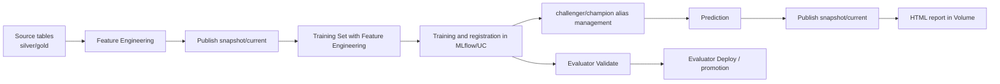

# falaj-machine-learning

Databricks Asset Bundle (DAB) for MLOps on Databricks, designed for the full machine learning lifecycle: feature engineering, training, model registration, prediction, reporting, operational validation, and promotion.

This repository follows patterns close to Databricks MLOps Stacks: environment separation, Unity Catalog governance, MLflow model versioning, job-based execution, controlled promotion of assets, and deployment automation through Databricks Asset Bundles.

## Repository purpose

This project exists to standardize how machine learning analyses and solutions are built and operated inside the Databricks workspace.

In practice, it does the following:

- organizes notebooks and jobs in a Git-versioned structure;
- packages and publishes assets through Databricks Asset Bundles;
- separates `dev`, `train`, and `prod` environments;
- reads source data from `silver` and `gold` layers;
- publishes outputs using the `snapshot/current` pattern;
- creates training sets with Unity Catalog Feature Engineering;
- registers models in MLflow and Unity Catalog;
- uses aliases such as `challenger` and `champion`;
- generates HTML reports in Unity Catalog volumes;
- supports validation, promotion, and operational smoke tests;
- supports standardized operational patterns for ML assets.

## MLOps architecture

The main repository flow is:



## Repository structure

```text
.
|-- databricks.yml
|-- dabs/
|   |-- resources/
|   |   |-- jobs_solutions.yml
|   |   `-- jobs_ops.yml
|   `-- targets/
|       |-- dev.yml
|       |-- train.yml
|       `-- prod.yml
|-- models/
|   |-- 00_config.py
|   |-- models_structure.py
|   `-- reference_ml_template/
|       |-- 00_config_reference_ml_template.py
|       |-- 01_feature_engineering.py
|       |-- 02_model_training.py
|       |-- 03_model_prediction.py
|       `-- 04_report.py
|-- core/
|   |-- utils.py
|   `-- uc_feature_store.py
`-- ops/
    |-- evaluator/
    |   |-- evaluator_validate.py
    |   `-- evaluator_deploy.py
```

## What each directory does

### `databricks.yml`

Root bundle file. It defines:

- the bundle name: `falaj-machine-learning`;
- global variables such as `environment`, `analysis_cluster_id`, and schedule pause settings;
- inclusion of targets and bundle resources.

### `dabs/targets`

Defines the bundle environments:

- `dev`: development environment, with a user-specific workspace root path;
- `train`: intermediate training and operational environment, including evaluator jobs;
- `prod`: production environment.

### `dabs/resources`

Contains the bundle jobs:

- `jobs_solutions.yml`: jobs for ML solutions and analyses;
- `jobs_ops.yml`: reserved for shared operational jobs; currently empty;
- in `train.yml`, there are operational jobs for `evaluator_validate` and `evaluator_deploy`.

### `models`

This is the functional core of the project. It contains:

- shared global configuration in `models/00_config.py`, including environment detection, source table names, read/write rules, and common naming helpers;
- the structural registry of supported solutions in `models/models_structure.py`;
- solution folders such as `models/reference_ml_template/`.

### `core`

Shared library for notebooks:

- `utils.py`: publishing conventions, naming, deploy helpers, smoke tests, reports, and model operations;
- `uc_feature_store.py`: reusable bridge to Unity Catalog Feature Engineering.

### `ops`

Operational flows:

- `evaluator/`: validation and operational deploy/promotion.

## Environments and behavior

The repository works with `dev`, `train`, and `prod`, but read and write behavior is not identical across them.

Based on the logic in `models/00_config.py`:

- in `dev`, reads use `prod_silver` and `prod_gold`, and writes go to `ml_train`;
- in `train`, reads use `prod_silver` and `prod_gold`, and writes go to `ml_train`;
- in `prod`, reads use `prod_silver` and `prod_gold`, and writes go to `ml_prod`.

This allows development in `dev`, training and validation in the training catalog, and production operation with separate governance.

Every new solution must reference `models/00_config.py`, because this file is the global source of truth for environment behavior, shared lakehouse table names, output catalog selection, and repository-wide conventions for writing data, reports, and models.

## Repository conventions

### 1. `snapshot/current` pattern

Tables published by the project follow this convention:

- `*_snapshot`: append-only historical table;
- `*_current`: view of the current state from the latest approved or published run.

When publishing with `publish_table()` in [core/utils.py](/Users/angelo-neto/Documents/Code/Zetta/falaj-machine-learning/core/utils.py), the framework adds metadata such as:

- `run_id`
- `run_ts`
- `ref_date`
- `analysis_name`

It also attempts to apply informational primary key constraints in Unity Catalog when configured.

### 2. Naming convention

In this repository, `SUBJECT` refers to the logical solution name.
In code, this is typically the value assigned to `SUBJECT_NAME` in the analysis config file.

For the reference template:

- `reference_ml_template` is the `SUBJECT`;
- `baseline` is the base analysis name.

The important distinction is:

- one `SUBJECT` can contain multiple analyses;
- `analysis_name` identifies one specific analysis inside that subject;
- `baseline` is the default or base analysis for the subject.

So the structure is not "one subject = one analysis".
Instead, the structure is "one subject = one solution, which may contain multiple analyses".

Example:

- `user_segmentation` is a `SUBJECT`;
- inside `user_segmentation`, you may have a base analysis and also variants such as live casino, online casino, or combined online + live casino;
- each of those variants is a different `analysis_name` under the same `SUBJECT`.

This means a single subject may generate multiple sets of tables, models, and reports, one for each analysis.

The standard naming pattern is driven by `SUBJECT` + `analysis_name`.

Typical patterns are:

- feature snapshot table: `ml_train.<SUBJECT>.feat_<analysis_name>_snapshot`
- feature current table: `ml_train.<SUBJECT>.feat_<analysis_name>_current`
- prediction snapshot table: `ml_train.<SUBJECT>.pred_<analysis_name>_snapshot`
- prediction current table: `ml_train.<SUBJECT>.pred_<analysis_name>_current`
- model name: `ml_train.<SUBJECT>.mdl_<analysis_name>`
- report location: `/Volumes/ml_train/<SUBJECT>/reports/<report_name>`

The exact table and report templates are defined per subject in `models/models_structure.py`, but the governing idea is always the same: the subject identifies the solution namespace, and the analysis name identifies the specific analysis variant inside that namespace.

Example using the `reference_ml_template` subject and the `baseline` analysis:

- feature snapshot: `ml_train.reference_ml_template.feat_baseline_snapshot`
- feature current: `ml_train.reference_ml_template.feat_baseline_current`
- prediction snapshot: `ml_train.reference_ml_template.pred_baseline_snapshot`
- prediction current: `ml_train.reference_ml_template.pred_baseline_current`
- model: `ml_train.reference_ml_template.mdl_baseline`
- report: `/Volumes/ml_train/reference_ml_template/reports/reference_report_baseline.html`

Example using the `user_segmentation` subject:

- base analysis:
  `ml_train.user_segmentation.feat_baseline_snapshot`
- live casino analysis:
  `ml_train.user_segmentation.feat_live_casino_snapshot`
- online casino analysis:
  `ml_train.user_segmentation.feat_online_casino_snapshot`
- combined online + live casino analysis:
  `ml_train.user_segmentation.feat_online_live_casino_snapshot`

Those are different analyses under the same subject.

### 3. Model governance

The project uses MLflow + Unity Catalog to:

- register models;
- version artifacts;
- assign aliases such as `challenger` and `champion`;
- validate candidates;
- promote aliases operationally.

### 4. Reports

Reports are written into Unity Catalog volumes. The `write_report_with_single_backup()` utility keeps a backup copy of the previous file using the `.bkp` suffix.

## How the reference solution works

The `models/reference_ml_template` folder is the official template for creating new analyses.

The configuration model is split into two layers:

- global configuration: `models/00_config.py`
- local solution configuration: `models/reference_ml_template/00_config_reference_ml_template.py`

This distinction is important.

`models/00_config.py` is mandatory for every solution and is responsible for global settings such as:

- environment detection (`dev`, `train`, `prod`);
- read environment selection;
- write catalog selection;
- shared source table names from the lakehouse `silver` and `gold` schemas;
- shared report and model path helpers;
- repository-wide conventions for where tables, reports, and models are written.

Then the solution can define its own local configuration on top of that.
In the reference template, that local layer is `00_config_reference_ml_template.py`, which references `../00_config` and adds solution-specific settings such as subject name, analysis mapping, aliases, table prefixes, and modeling parameters.

It implements the full flow:

1. `00_config_reference_ml_template.py`
   Defines the subject, tables, aliases, available analyses, and template helpers. It is the local config layer for the solution and must reference `models/00_config.py`. In this template, `reference_ml_template` is the `SUBJECT_NAME`, and `baseline` is the default analysis name.
2. `01_feature_engineering.py`
   Reads source data, builds features and labels, and publishes feature tables.
3. `02_model_training.py`
   Creates the training set through Unity Catalog Feature Engineering, trains the model, and registers the candidate.
4. `03_model_prediction.py`
   Scores data using Feature Engineering `score_batch` and publishes predictions.
5. `04_report.py`
   Consolidates metrics and generates an HTML report.

## Mandatory MLOps functions

When implementing a new solution, it is mandatory to use the repository MLOps helpers instead of creating ad hoc patterns for publishing, training set creation, model registration, lineage, candidate handling, and report writing.

This list refers to the solution implementation itself.
Validation and alias promotion are not part of the solution notebooks and should not be embedded into training code.
Those responsibilities belong to the evaluator pipeline.

These are the most important functions:

- `publish_table()` in [core/utils.py](/Users/angelo-neto/Documents/Code/Zetta/falaj-machine-learning/core/utils.py)
  Mandatory for publishing output tables such as features and predictions. It enforces the `snapshot/current` convention, injects run metadata such as `run_id`, `run_ts`, `ref_date`, and `analysis_name`, and applies Unity Catalog primary key conventions when configured.
- `read_current_table()` in [core/utils.py](/Users/angelo-neto/Documents/Code/Zetta/falaj-machine-learning/core/utils.py)
  Recommended standard way to read the current published state of a table.
- `get_feature_engineering_client()` in [core/utils.py](/Users/angelo-neto/Documents/Code/Zetta/falaj-machine-learning/core/utils.py)
  Standard entry point to the Databricks Feature Engineering client.
- `create_feature_training_set()` in [core/utils.py](/Users/angelo-neto/Documents/Code/Zetta/falaj-machine-learning/core/utils.py)
  Standard repository wrapper around Databricks Feature Engineering `create_training_set`.
- `create_training_set_from_feature_tables()` in [core/uc_feature_store.py](/Users/angelo-neto/Documents/Code/Zetta/falaj-machine-learning/core/uc_feature_store.py)
  Preferred high-level helper to build the training set from the subject feature tables. Use this instead of assembling Feature Lookups manually in each solution unless there is a very specific reason not to.
- `log_model_with_feature_lineage()` in [core/utils.py](/Users/angelo-neto/Documents/Code/Zetta/falaj-machine-learning/core/utils.py)
  Core function for logging and registering models with Unity Catalog Feature Engineering lineage.
- `register_model_with_uc_feature_lineage()` in [core/uc_feature_store.py](/Users/angelo-neto/Documents/Code/Zetta/falaj-machine-learning/core/uc_feature_store.py)
  Higher-level helper for model registration with feature lineage.
- `create_training_set_and_register_model()` in [core/uc_feature_store.py](/Users/angelo-neto/Documents/Code/Zetta/falaj-machine-learning/core/uc_feature_store.py)
  One-shot helper that combines training set creation and model registration with lineage. Use it when the solution benefits from a single standardized path.
- `build_model_name()` in [core/utils.py](/Users/angelo-neto/Documents/Code/Zetta/falaj-machine-learning/core/utils.py)
  Mandatory for generating standard model names from `SUBJECT` and `analysis_name`.
- `register_candidate()` in [core/utils.py](/Users/angelo-neto/Documents/Code/Zetta/falaj-machine-learning/core/utils.py)
  Standard way to assign the candidate alias, typically `challenger`, after training.
- `write_report_with_single_backup()` in [core/utils.py](/Users/angelo-neto/Documents/Code/Zetta/falaj-machine-learning/core/utils.py)
  Standard way to write reports while preserving a backup of the previous version.

In addition to those helpers, prediction flows should follow the repository standard and use Databricks Feature Engineering `score_batch` for inference when the solution is built on UC feature lineage, as shown in the reference template.

Validation, promotion, and deploy smoke tests should be executed through the evaluator pipeline, not directly from the training notebook.

## Recommended development workflow

The typical development flow for a new solution in this repository is:

1. Create your working branch:

   ```bash
   git checkout -b <subject_name>
   ```

2. Authenticate in Databricks:

   ```bash
   databricks auth login --profile <profile_name>
   ```

3. Run the first deploy:

   ```bash
   databricks bundle deploy
   ```

   In this repository, `dev` is the default target. On the first deploy, this command is typically used to create the user's personal development area in the Databricks dev workspace:

   ```text
   /Workspace/falaj-machine-learning/dev/${workspace.current_user.userName}
   ```

   It also creates or updates the bundle-defined resources for `dev`, including the jobs defined in `dabs/resources/jobs_solutions.yml`.

4. Create your solution notebooks and configuration files following the section `How to create a new solution (new SUBJECT)`.

5. Sync notebooks and source files during development:

   ```bash
   databricks bundle sync
   ```

   This is the standard command to push notebook and source-file updates into your personal Databricks development area while you are iterating.

6. Run deploy again when needed:

   ```bash
   databricks bundle deploy
   ```

   Use `bundle deploy` again when you want to synchronize bundle-managed resources, especially when you create or change jobs, update bundle configuration, or want to refresh the deployed assets in the dev target.

7. Commit your changes:

   ```bash
   git commit -m "<describe your changes>"
   ```

8. Push your branch:

   ```bash
   git push -u origin <branch_name>
   ```

9. Open GitLab and create the merge request from your branch.

## How to create a new solution (new SUBJECT)

This section is about creating a new solution namespace, meaning a new `SUBJECT`.
It is not about adding another `analysis_name` inside an existing subject.

To create a new solution in this repository, follow this pattern.

If you only want to add a new `analysis_name` inside an existing subject, that is a smaller change.
In that case, you usually update the existing solution configuration, analysis mapping, jobs, and outputs, instead of creating a brand-new solution folder and a new subject entry.

### Step 1. Use `reference_ml_template` as the base

Every new solution must use `models/reference_ml_template` as its structural and technical reference.

Every new solution must also reference `models/00_config.py` through its local config file.
This is mandatory.

The expected pattern is:

- global config in `models/00_config.py`;
- local solution config in `models/<your_solution>/00_config_<your_solution>.py`.

The local config should reference the global config and then add only the solution-specific settings.

That means reusing the same file layout:

- `00_config_<solution>.py`
- `01_feature_engineering.py`
- `02_model_training.py`
- `03_model_prediction.py`
- `04_report.py`

### Step 2. Create a new folder inside `models`

Every new solution must have its own folder inside `models`.

Example:

```text
models/
`-- my_new_solution/
    |-- 00_config_my_new_solution.py
    |-- 01_feature_engineering.py
    |-- 02_model_training.py
    |-- 03_model_prediction.py
    `-- 04_report.py
```

### Step 3. Add the solution structure to `models/models_structure.py`

Every new solution must also be registered in `models/models_structure.py`.

That file defines the operational structure of the solution, including:

- schema;
- report folder;
- table templates;
- model name template;
- report templates;
- optional `feature_rebind` configuration.

Without this step, several core repository operations will not work correctly, especially:

- naming conventions;
- deploy flow;
- promotion;
- smoke tests;
- table, report, and model resolution.

### Step 4. Create the solution jobs in `dabs/resources/jobs_solutions.yml`

For every solution, it is also mandatory to create the jobs in `dabs/resources/jobs_solutions.yml`:

- one `training` job;
- one `prediction` job.

The current template pattern is:

- training job:
  `feature_engineering -> model_training -> model_prediction -> html_report`
- prediction job:
  `feature_engineering -> model_prediction -> html_report`

Also make sure to adjust:

- `name`;
- `tags`;
- `schedule`;
- `notebook_path`;
- `base_parameters`;
- the cluster used (`existing_cluster_id`).

### Step 5. Update the internal solution configuration

Inside the new solution folder, you should update at least:

- the local config so it references `models/00_config.py`;
- `SUBJECT_NAME`;
- write schema settings;
- table prefixes;
- model aliases;
- the `ANALYSIS_NAMES` mapping;
- feature column and label logic;
- report rules.

As a rule:

- `models/00_config.py` defines global configuration;
- `00_config_<your_solution>.py` defines local configuration for the solution.

Use the global config for repository-wide concerns such as environment, source tables, output locations, and shared helpers.
Use the local config for solution-specific concerns such as the subject name, analysis list, aliases, table prefixes, labels, and modeling parameters.

### Step 6. Use the mandatory MLOps helper functions

New solutions should not implement custom publishing, custom model naming, or custom lineage registration paths when the repository already provides the standard helpers.

At minimum, the solution should follow these rules:

- use `publish_table()` to publish features and predictions;
- use `create_feature_training_set()` or, preferably, `create_training_set_from_feature_tables()` for training set creation;
- use `log_model_with_feature_lineage()` or `register_model_with_uc_feature_lineage()` for model logging with lineage;
- use `build_model_name()` for model naming;
- use `register_candidate()` after training;
- use `write_report_with_single_backup()` for report generation;
- use `score_batch` in prediction flows when following the UC Feature Engineering pattern.

Do not place `validate_candidate()` or `promote_alias()` directly in the solution training flow.
It is not ideal to validate or promote aliases automatically every time training runs.
Those steps must happen through the evaluator pipeline.

### Step 7. Deploy the bundle

Users should deploy with:

```bash
databricks bundle deploy
```

In this repository, `dev` is the default target. This means the deploy goes to the user's personal folder in the Databricks dev workspace:

```text
/Workspace/falaj-machine-learning/dev/${workspace.current_user.userName}
```

In other words, each user deploys to their own workspace path in the `dev` environment.

The same `databricks bundle deploy` command also creates or updates the bundle-defined resources for `dev`, including the jobs declared in `dabs/resources/jobs_solutions.yml`.

## About `models/models_structure.py`

This file is the central registry of the solutions known by the framework.

Today it already contains structures for:

- `user_segmentation`
- `cross_sell_mba`
- `reference_ml_template`

Even when the full implementation of a solution is not entirely present in this repository, this structural catalog is still used by shared utilities to:

- build model names;
- assemble table and report paths;
- drive deploy and smoke tests;
- configure feature lineage rebinding when applicable.

## Operational jobs

Besides solution jobs, the repository also includes evaluator operations in `ops/evaluator`:

- `evaluator_validate.py`
  validates whether a candidate model can proceed in the flow;
- `evaluator_deploy.py`
  runs operational promotion, planned deployment, and smoke tests.

In the `train` target, these jobs are already declared for `reference_ml_template`.

The evaluator is the operational gate of the MLOps flow.
It can be executed by the same person who trained the model, but validation and promotion should still happen through the evaluator pipeline, not by embedding those actions directly in the training notebook.

In practice:

- training should create and register the candidate model;
- when you want to validate the candidate, run the evaluator;
- when you want to promote aliases or execute deployment checks, run the evaluator pipeline;
- do not automatically promote aliases from inside the training notebook.

## Important architectural notes

### The project is notebook-first

The `.py` files in this repository are Databricks notebooks exported into Git. This improves reviewability, deployment, and traceability.

### Cross-catalog model deployment has a specific rule

The deploy logic in [core/utils.py](/Users/angelo-neto/Documents/Code/Zetta/falaj-machine-learning/core/utils.py) makes it explicit that, in the current architecture, cross-catalog model deployment is disabled. The main promotion happens through alias management on the source model, while tables and reports may be promoted separately.

In other words, production model governance depends on the defined operational flow, not on blindly copying artifacts between catalogs.

### The template already uses Unity Catalog Feature Engineering

The reference template training and prediction flow already uses:

- `create_training_set`;
- `FeatureLookup`;
- `score_batch`;
- `log_model` with feature lineage.

This is an important part of the repository MLOps design.

## Checklist for a new solution

Before considering a new solution ready, confirm that:

- the new folder was created inside `models`;
- the implementation was based on `reference_ml_template`;
- the structure was registered in `models/models_structure.py`;
- there is a `training` job in `dabs/resources/jobs_solutions.yml`;
- there is a `prediction` job in `dabs/resources/jobs_solutions.yml`;
- notebook paths in the bundle are correct;
- schema, model name, and reports follow repository conventions;
- the bundle deploy was tested in the correct environment.

## Summary

This repository is the MLOps framework for the `falaj-machine-learning` project on Databricks.

It is not just a set of notebooks: it defines a complete operational architecture to develop, publish, register, validate, promote, and operate machine learning solutions with a consistent standard.

If you are creating a new solution, the rule is simple:

1. use `reference_ml_template` as the base;
2. create a new folder inside `models`;
3. add the solution to `models/models_structure.py`;
4. create the two solution jobs in `dabs/resources/jobs_solutions.yml`:
   training and prediction.

Following this pattern keeps the new solution compatible with the MLOps standard adopted by the repository.
